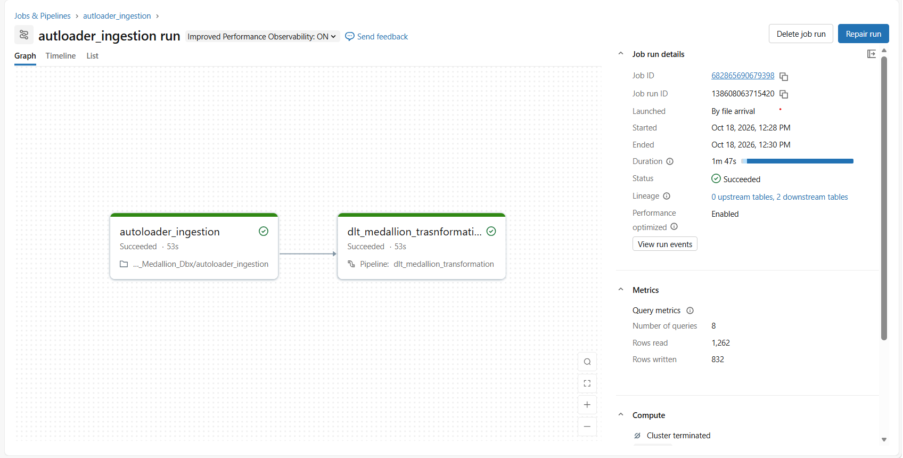
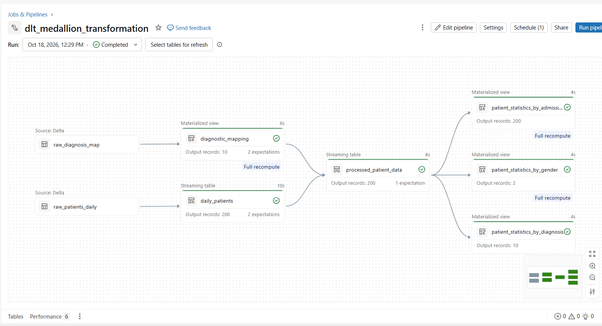
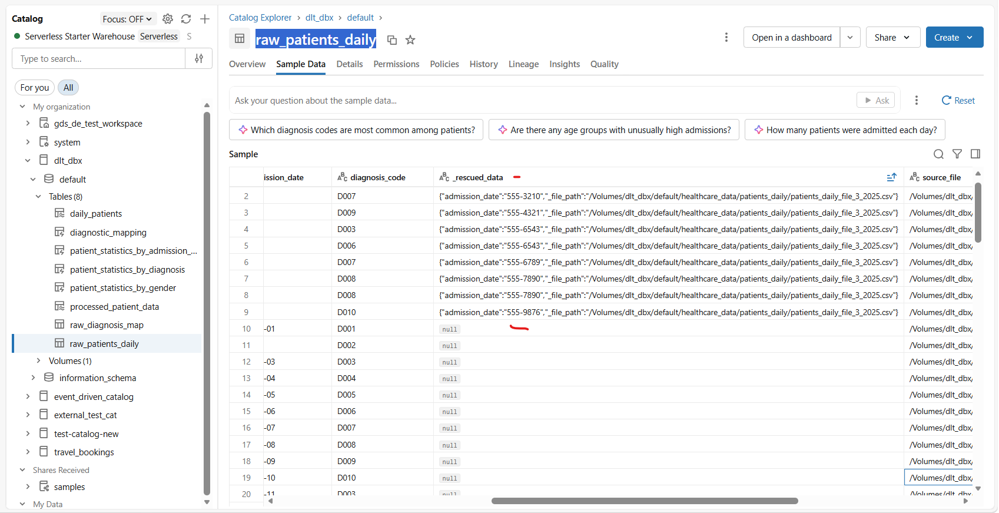
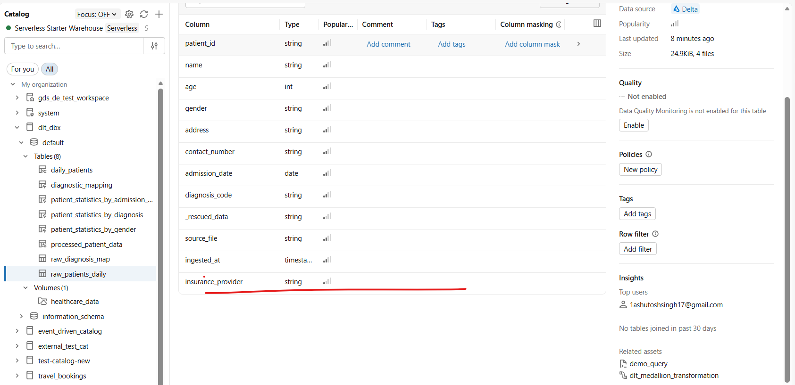

# Healthcare Auto Loader Medallion Pipeline

Ingest healthcare CSV files with Databricks Auto Loader and transform them
through Bronze, Silver, and Gold using a Lakeflow Declarative Pipeline.

## Pipeline overview

Auto Loader incrementally appends new CSV files to raw Delta tables. The
Lakeflow Declarative Pipeline validates the data, enriches patient records with
diagnosis descriptions, and publishes analytics.

| Layer | Tables | Purpose |
|---|---|---|
| Raw | `raw_diagnosis_map`, `raw_patients_daily` | Auto Loader Delta inputs |
| Bronze | `diagnostic_mapping`, `daily_patients` | Typed, validated source data |
| Silver | `processed_patient_data` | Patient data enriched with diagnosis descriptions |
| Gold | `patient_statistics_by_admission_date`, `patient_statistics_by_diagnosis`, `patient_statistics_by_gender` | Admission and demographic analytics |

Gold outputs include patient counts and age statistics, grouped by admission
date, diagnosis, or gender.

## Prerequisites and inputs

The notebooks are configured for catalog `dlt_dbx`, schema `default`, and
volume `/Volumes/dlt_dbx/default/healthcare_data`. Create or update these Unity
Catalog resources and grant the job and pipeline access before running.

| CSV data | Volume folder | Destination |
|---|---|---|
| Diagnosis codes and descriptions | `diagnosis_mapping/` | `dlt_dbx.default.raw_diagnosis_map` |
| Daily patient records | `patients_daily/` | `dlt_dbx.default.raw_patients_daily` |

Patient filenames must match `patients_daily_file_*.csv`. Auto Loader stores
inferred schemas in `_schemas/` and progress in `_checkpoints/` under the
volume. Preserve these directories between incremental runs.

## Processing behavior

- Auto Loader processes new CSV files with an AvailableNow trigger and stops
  when the available files are ingested.
- Incompatible values can be retained in `_rescued_data`; raw patient rows
  also include `source_file` and `ingested_at` lineage columns.
- Bronze expectations drop rows missing required patient or diagnosis fields.
  Duplicate diagnosis codes resolve to the latest ingested mapping.
- Silver drops patients without a matching diagnosis description. Gold
  materialized views aggregate the valid Silver records.
- When Auto Loader detects new columns, retry ingestion if the run stops for
  schema evolution, then refresh the pipeline.

## Run

1. Upload CSV files to the volume folders above.
2. Run [`autoloader_ingestion.ipynb`](./autoloader_ingestion.ipynb).
3. Refresh the Lakeflow Declarative Pipeline, configured with target
   `dlt_dbx.default`, using [`dlt_processing.ipynb`](./dlt_processing.ipynb)
   **or** [`dlt_transformation.ipynb`](./dlt_transformation.ipynb). These
   notebooks define the same datasets; add only one as the pipeline source.
4. Review the pipeline graph and output tables in Catalog Explorer.

## Example run

Screenshots from successful runs and schema/rescued-data examples. Click an
image to open it full size.

For date-format recovery, failed-update troubleshooting, and protecting raw
tables, see the [operations guide](./OPERATIONS.md).
